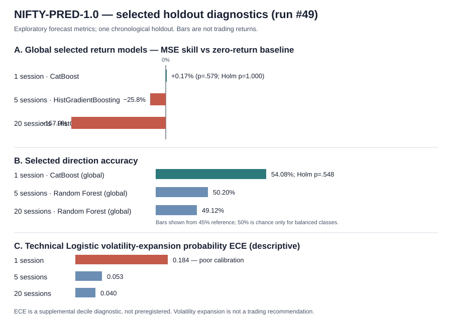

# Predicting NIFTY 50: a bounded comparison of statistical, machine-learning and sequence forecasts

**Research version:** NIFTY-PRED-1.0  
**Study date:** 14 October 2026  
**Manuscript status:** Tester-reviewed prediction-only manuscript; pass with scope limitations  
**Canonical run:** [GitHub Actions #49](https://github.com/vishnuvcr/Naked-Options-v2/actions/runs/38533512128)  
**Artifact SHA-256:** `97858125f14344520f77dd503d2c0441005e6da4cfa12fc23fe7427680f932e7`

## Abstract

This study tested whether technical and lagged global-market information improves NIFTY 50 forecasts over simple benchmarks at 1-, 5- and 20-session horizons. A cached daily NIFTY series contained 4,901 observations from 2 January 2007 through 13 October 2026. Seven external daily series passed validation. A bounded catalogue compared linear models, tree ensembles, boosted models, classifiers and compact sequence models using chronological development/holdout separation and expanding time-series cross-validation. The corrected workflow evaluated 139,289 out-of-sample prediction rows across targets and feature sets. The previously identified partial-forward-window volatility-label defect was fixed, and the regression tests and corrected workflow passed. Independent checks reproduced regression skill metrics, moving-block confidence intervals, Holm adjustments and the ARIMA benchmark. The selected global one-session return model improved MSE by only 0.17% over zero return (p=.579; Holm p=1); the selected global one-session direction model achieved 54.08% accuracy but did not survive multiplicity correction (Holm p=.548). Selected global 5- and 20-session return models performed worse than the zero-return benchmark. Some volatility-expansion classifiers improved log loss, but probability calibration was weak at one session and results remain single-holdout estimates. The independent tester passed the bounded prediction-only study with scope limitations. No options trading strategy was tested or approved.

**Keywords:** NIFTY 50, forecast evaluation, machine learning, time-series validation, volatility, out-of-sample prediction, multiplicity correction.

## 1. Introduction

Forecasts of a broad equity index can appear accurate when models learn price persistence, trend or scale. Price-level fit therefore does not itself establish useful return predictability. A model intended for decision support must be compared with simple target-specific benchmarks on data not used for model selection, with uncertainty and multiple comparisons handled explicitly.

The study asks whether a bounded catalogue of statistical, machine-learning and sequence models improves forecasts of NIFTY 50 levels, log returns, direction and forward volatility at 1-, 5- and 20-session horizons. The study is prediction research, not a trading-strategy study.

## 2. Research questions and hypotheses

The protocol and detailed research questions are recorded in [RESEARCH_QUESTIONS.md](RESEARCH_QUESTIONS.md) and [RESEARCH_PLAN.md](RESEARCH_PLAN.md).

1. Do candidate models improve out-of-sample forecasts over zero-return, persistence or historical-prevalence benchmarks?
2. Does adding lagged global-market information improve performance relative to technical-only features?
3. Does performance vary by target and horizon?
4. Do any improvements survive dependence-aware uncertainty estimation and Holm multiplicity correction?

The working null for each candidate is no improvement over its target-specific baseline. Price-level scores are not interpreted as movement-prediction skill.

## 3. Literature review and research gap

The repository's [literature review](LITERATURE_REVIEW.md) and [source register](DATA_CATALOG.md) summarize the prior NIFTY prediction literature and data provenance. Prior studies use technical indicators, linear models, tree ensembles, support-vector methods and neural sequence models, but comparisons can be difficult to interpret when horizons, splits, baselines and metrics differ. The present experiment addresses a narrower reproducibility gap by freezing a bounded catalogue, using chronological evaluation, recording unavailable inputs, and preserving predictions and metrics for independent recomputation.

This review is a first-pass synthesis, not a claim of exhaustive coverage of every paper, video or dataset. Literature findings are not treated as results of this experiment.

## 4. Data and provenance

The canonical run's data manifest is in the run artifact. The NIFTY daily cache contains 4,901 rows spanning 2007-01-02 to 2026-10-13. The Dhan cache was retained and cross-checked against Yahoo NIFTY observations over 4,679 overlapping rows; median absolute close difference was approximately 0.0001953 and maximum approximately 0.0007813 in the stored series' units.

Validated external series: S&P 500, Nasdaq, Nikkei 225, Hang Seng, CBOE VIX, India VIX proxy and US 10-year yield proxy. USD/INR, gold and WTI were rejected by strict validation, and an NSE endpoint returned no recognized rows. External features are joined with a backward as-of merge that excludes exact same-date matches, reducing look-ahead risk from market-close timing.

Historical option chains, PCR, FII/DII, breadth, point-in-time constituents, corporate-action event features and timestamped news/sentiment were not verified as acquired. Their absence limits market-regime and options-related conclusions. Twenty weekend-dated index rows were preserved and flagged rather than automatically deleted.

## 5. Methods

### 5.1 Targets and horizons

Targets were constructed for 1, 5 and 20 sessions:
- future log return and direction;
- future price level;
- forward volatility proxy (absolute next return for horizon 1; standard deviation of future returns for longer horizons);
- volatility-expansion indicator relative to lagged 20-session volatility.

The target-window defect found in the earlier artifact was corrected by requiring every future return in a multi-session volatility window to be present. Run #49 passed the boundary regression test. The final prediction artifact contains zero missing target dates and no target date on or before its forecast origin; available origin/target pairs align with the declared horizons.

### 5.2 Features and model catalogue

Technical features include lagged returns, momentum, rolling volatility, absolute-return averages, intraday range, overnight gap, volume and RSI. Global features use lagged external closes/returns. The catalogue includes linear models, SVM/SVR, random forests, extra trees, histogram gradient boosting, MLP, XGBoost, LightGBM, CatBoost and compact LSTM/GRU/TCN/Transformer sequence estimators. The compute-budget amendment was fixed before accepting results: full catalogue for one-session return and direction, and a core model set for other target/horizon cells. Excluded cells are labelled `BLOCKED_COMPUTE_BUDGET`.

### 5.3 Chronological evaluation

The series was split chronologically: the first 80% for development and the final 20% for holdout evaluation. Candidate selection used two expanding time-series folds, with a horizon-based gap between training labels and validation origin. The holdout was not used to choose the model. The run produced 491 merged metric rows, including 143 OOS-evaluated rows and 208 explicitly compute-budget-blocked rows.

### 5.4 Benchmarks and metrics

Returns were compared with a zero-return benchmark; price levels with persistence; classification with a development-sample prevalence baseline; and returns also with ARIMA(1,0,0). Metrics include MAE, RMSE, benchmark-relative MSE skill, accuracy, balanced accuracy, Brier score/skill, log loss, volatility QLIKE, HAC paired-loss tests, moving-block confidence intervals and Holm adjustment within task/horizon families. The exact executable definitions are in [forecast_metrics.py](../scripts/forecast_metrics.py).

### 5.5 Independent verification

The independent tester examined the corrected artifact and separately recomputed 91 regression skill metrics (maximum absolute difference approximately 2.04e-9), 140 non-ARIMA block confidence intervals (maximum difference below 8e-9), Holm adjustments (maximum difference below 1e-16), and ARIMA benchmark skill/HAC/interval results. The tester report is [here](https://github.com/vishnuvcr/Naked-Options-v2/blob/research/independent-tester/research/TESTER_REPORT.md).

## 6. Results

### 6.1 Selected holdout results

| Target | Horizon | Selected model / features | n | Key score | Inference |
|---|---:|---|---:|---|---|
| Log return | 1 | CatBoost / global | 980 | MSE skill +0.17% vs zero return | p=.579; Holm p=1.000 |
| Log return | 5 | HistGradientBoosting / global | 976 | MSE skill -25.8% | Holm p=.0256; worse than baseline |
| Log return | 20 | HistGradientBoosting / global | 961 | MSE skill -157.0% | Holm p=.000054; worse than baseline |
| Direction | 1 | CatBoost / global | 980 | Accuracy 54.08%; balanced accuracy 51.96% | Holm p=.5478 |
| Direction | 5 | Random Forest / global | 976 | Accuracy 50.20% | Holm p=.8206 |
| Direction | 20 | Random Forest / global | 961 | Accuracy 49.12% | Holm p=.3061 |
| Price level | 1 | ElasticNet / global | 980 | MSE skill -17.7% vs persistence | Negative skill |
| Price level | 5 | ElasticNet / global | 976 | MSE skill -10.3% vs persistence | Negative skill |
| Price level | 20 | Ridge / global | 961 | MSE skill -38.9% vs persistence | Negative skill |
| Volatility | 1 | ElasticNet / global | 980 | MSE skill +10.8%; QLIKE skill -19.8% | Holm p=.3165 |
| Volatility | 5 | ElasticNet / global | 976 | MSE skill +33.1%; QLIKE skill +6.3% | Holm p=1.000 |
| Volatility | 20 | ElasticNet / global | 961 | MSE skill +38.3%; QLIKE skill +29.9% | Holm p=.2843 |
| Volatility expansion | 1 | Logistic / technical | 980 | Accuracy 55.31%; Brier skill -12.1% | Log-loss Holm p=.000487; calibration concern |
| Volatility expansion | 5 | Logistic / technical | 976 | Accuracy 61.99%; Brier skill +6.9% | Log-loss Holm p=.0233 |
| Volatility expansion | 20 | Logistic / technical | 961 | Accuracy 65.76%; Brier skill +13.0% | Log-loss Holm p=.0109 |

### 6.2 ARIMA benchmark

ARIMA(1,0,0) return MSE skill versus zero return was -0.35% at 1 session (p=.492), +0.11% at 5 sessions (p=.935) and +1.07% at 20 sessions (p=.842). Confidence intervals included zero at all three horizons. The ARIMA prediction artifact and metrics were checked separately from the merged model prediction file.

### 6.3 Calibration diagnostic

Supplemental decile expected calibration error (ECE), not a preregistered primary endpoint, was 0.016 for selected global CatBoost one-session direction probabilities. For selected technical Logistic volatility-expansion probabilities, ECE was 0.184, 0.053 and 0.040 at 1, 5 and 20 sessions. The one-session expansion model is poorly calibrated by this descriptive diagnostic. Single-holdout ECE is not evidence of future stability.

## 7. Discussion

The results do not demonstrate robust useful return or directional prediction. The selected one-session return model's MSE improvement is negligible and statistically unsupported; the direction result is close to chance and fails Holm correction. Selected global return models at 5 and 20 sessions are worse than zero return. Price-level models do not beat persistence despite the level's natural serial dependence.

Volatility scores are metric-sensitive: selected ElasticNet models improve MSE at each horizon, but the QLIKE comparisons do not pass multiplicity correction. Volatility-expansion classification shows adjusted log-loss improvements at 5 and 20 sessions in the technical-only set, but this is exploratory, single-holdout evidence; the 1-session model has negative Brier skill and high ECE. It should not be interpreted as a deployable signal.

The global-feature experiment used conservative prior-date joins, but only seven external series were validated and full regime segmentation was not performed. These results cannot answer whether options-implied volatility, put-call ratios, FII/DII flows, breadth, news sentiment or corporate-action context would add value because those inputs were not acquired.

## 8. Strengths and limitations

### Strengths
- Strict chronological development/holdout separation and expanding time-series validation.
- Target-specific simple benchmarks rather than relying on price-level fit alone.
- Complete forward-window target construction with a regression test.
- Cached data and run artifact hashes for reproducibility.
- Explicit compute-budget exclusions, error log and independent tester branch.
- Independent reproduction of loss-skill, confidence interval, Holm and ARIMA calculations.

### Limitations
- One holdout period; no independent second-market-regime replication.
- Global auxiliary data coverage is incomplete; timing/holiday alignment still deserves a dedicated sensitivity analysis.
- No verified historical option chains, PCR, FII/DII, breadth, timestamped news, point-in-time constituents or corporate-action event features.
- Some model families are compute-budget-screened for longer horizons, so no all-family winner is inferred there.
- Calibration ECE is a supplemental descriptive metric; no probability recalibration was fitted and validated on a separate period.
- This is not a trading backtest. Brokerage, bid/ask spread, slippage, taxes, margin, liquidity and Paytm Money execution were not simulated.

## 9. Conclusion

For the bounded data and model universe tested, there is no robust evidence that complex models improve NIFTY 50 return or direction forecasts over simple benchmarks. The best selected one-session return result is economically and statistically weak, while selected longer-horizon return forecasts are worse than zero return. Volatility-expansion classification offers a limited exploratory signal at 5/20 sessions, but it is not sufficient to justify a trading strategy and requires calibration and regime-stability validation.

The independent tester passed the prediction-only study with scope limitations. This is not evidence that prediction is impossible; it is evidence that this specified feature set and evaluation period did not establish a robust return/direction edge.

## 10. Future research

1. If data access permits, build a timestamp-aligned historical options dataset (implied volatility surface, open interest, volume, PCR and expiry distance) and verify survivorship and point-in-time rules.
2. Add validated FII/DII, breadth, corporate-action and timestamped news/sentiment features only under a new preregistered phase.
3. Test regime stability and probability calibration on a separate rolling-origin evaluation period.
4. Replicate the forecast evaluation on additional untouched periods before any trading-strategy study.
5. Only after a stable predictive hypothesis exists, build a separate execution study with realistic bid/ask, brokerage, taxes, slippage, margin and broker-specific constraints. No such strategy is proposed here.

## References

See [LITERATURE_REVIEW.md](LITERATURE_REVIEW.md) for the repository's source register. Literature claims are separate from the empirical results above.

## Appendix A. Reproducibility

- Workflow: [run #49](https://github.com/vishnuvcr/Naked-Options-v2/actions/runs/38533512128)
- Commit: `9b655da8d72667a6d2f15e4dad5df55a1bec2e84`
- Artifact SHA-256: `97858125f14344520f77dd503d2c0441005e6da4cfa12fc23fe7427680f932e7`
- Source manifest, data-quality report, model manifests, predictions, metrics and experiment errors are in the downloadable run artifact.
- [Results register](RESULTS.md), [phase gates](PHASE_STATUS.md), [error log](ERROR_LOG.md), [experiment log](EXPERIMENT_LOG.md), and [independent tester report](https://github.com/vishnuvcr/Naked-Options-v2/blob/research/independent-tester/research/TESTER_REPORT.md).

## Appendix B. Gate decision

The independent tester's disposition is **PASS WITH SCOPE LIMITATIONS** for this bounded prediction-only study. It does not approve an options strategy, live deployment or claims about data families that were not acquired.
