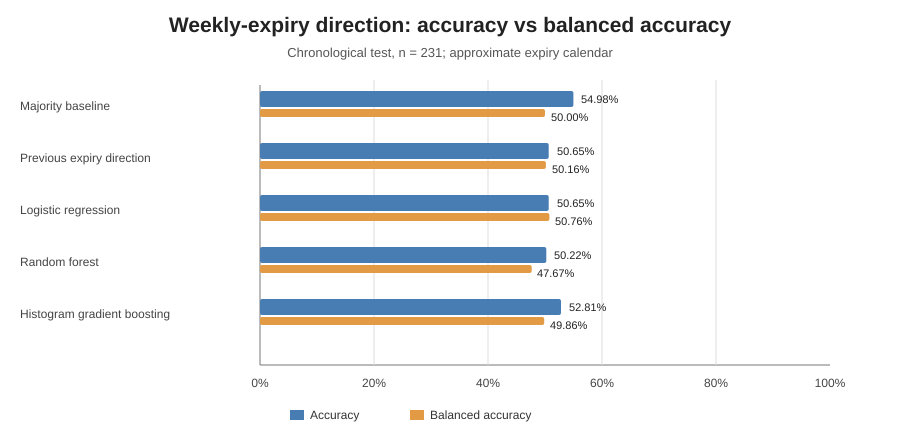

# NIFTY 50 Next-Session Direction Prediction — Research Manuscript (Living Draft)

**Updated:** 2026-10-25  
**Status:** Daily benchmark and dedicated weekly-expiry direction screen completed; no predictive edge or strategy is validated.  
**Scope:** Daily next-session and expiry-to-expiry NIFTY 50 spot direction. No live trading or options profitability is established.

## Abstract

The baseline daily prediction workflow completed successfully in [GitHub Actions run #34](https://github.com/vishnuvcr/Naked-Options-v2/actions/runs/40139816710). The third-party dataset has 4,686 daily rows from 2007-09-17 to 2026-10-23. The chronological holdout has 1,157 observations from 2022-02-14 to 2026-10-22. Previous-session direction achieved 54.19% accuracy and 54.10% balanced accuracy; logistic regression, random forest and histogram gradient boosting did not establish an improvement. A first screen of simple momentum, reversal, trend and volatility-conditioned rules also fails to identify a clearly superior candidate. The candidate-rule output is persisted in [candidate_rules.json](../../reports/nifty-prediction/candidate_rules.json); the gross proxy is not executable performance. All gross return proxies are pre-cost diagnostics, not executable strategy returns.

## 1. Research questions and objectives

1. Can daily OHLC-derived features predict next-session NIFTY 50 direction better than naive rules?
2. Do simple momentum, short-horizon reversal, trend and volatility-conditioned rules improve directional accuracy?
3. Does any surviving candidate retain value after realistic execution costs?
4. Which of the seven specified research repositories provides a method that can be adapted and empirically validated for this task?

## 2. Data and provenance

Primary source is Yahoo Finance daily NIFTY 50 (`^NSEI`), 4,686 rows from 2007-09-17 through 2026-10-23, SHA-256 `8d73f2b98d2109a5ccf6bfc6e85927de9f5c59ced889c188f6aa59a340079ab0`. A public parquet mirror matched all OHLC fields exactly across the same 4,686 dates. This is a parity check, not independent validation; both sources are third-party and may share upstream data. Neither is exchange-certified.

## 3. Methods

The target is the sign of next-session close-to-close return. The benchmark uses chronological expanding walk-forward fitting and evaluates a common 1,157-row final-quarter holdout. Candidate rules use information available at the current close: prior-session sign, 3- and 5-session momentum, 1- and 3-session reversal, close relative to a 20-session moving average, and a 20-session rolling-volatility regime. The regime cutoff is the 70th percentile of training-period volatility and is fixed before test scoring. Candidate screening is performed on the same date interval as the baseline.

Primary metric is balanced accuracy; accuracy and a simple daily long/short sign-of-return proxy are secondary diagnostics. The latter multiplies the next-session spot-index return by +1 or -1 according to predicted direction. It is gross and non-executable; it excludes instrument basis, costs, turnover, leverage, and execution constraints.

## 4. Verified initial model benchmark

| Model/rule | Accuracy | Balanced accuracy |
|---|---:|---:|
| Majority-class baseline | 52.20% | 50.00% |
| Previous-session direction | 54.19% | 54.10% |
| Logistic regression | 52.46% | 52.53% |
| Random forest | 50.56% | 50.44% |
| Histogram gradient boosting | 53.15% | 52.82% |

The previous-session direction rule has a 95% block-bootstrap balanced-accuracy interval of 51.30–56.81%. The learned models do not establish reliable improvement over that simple comparator.

## 5. First simple-rule screen

The automated candidate workflow computed and persisted these results on the common 1,157-row test interval.

| Rule | Accuracy | Balanced accuracy | Gross compounded sign proxy |
|---|---:|---:|---:|
| Previous-session direction | 54.19% | 54.10% | +81.39% |
| 3-session momentum | 53.33% | 53.18% | +16.30% |
| 5-session momentum | 51.60% | 51.42% | +8.59% |
| 1-session mean reversion | 45.89% | 45.99% | -47.78% |
| 3-session mean reversion | 46.67% | 46.82% | -21.03% |
| 20-session trend filter | 54.19% | 53.90% | +20.64% |
| Volatility-conditioned momentum/reversal | 50.82% | 50.71% | -28.85% |

Interpretation: neither momentum variant beats the previous-session direction baseline; reversal rules perform poorly; the trend filter ties raw accuracy but has lower balanced accuracy and lower gross sign-proxy performance. The volatility-conditioned rule does not help. The large gross proxy number for the baseline is not a trading result and cannot be used as evidence of profitability.

## 6. Volatility and optional-model experiments\n\nThe GARCH(1,1) forecast experiment used recursive daily variance updates with parameter refits every 20 sessions. QLIKE was -8.64595 for GARCH(1,1), -8.57379 for rolling 20-session variance, and -8.22293 for expanding unconditional variance (lower is better). This is a modest relative volatility-score improvement only; realized squared returns are noisy, and this result is not directional prediction skill. See [volatility forecast report](../../reports/nifty-prediction/volatility_forecast.json).\n\nA separate chronological 60/15/25 experiment on 4,626 valid feature rows scored logistic regression at 53.59% accuracy and 53.31% balanced accuracy over 1,157 test rows (2022-02-15 to 2026-10-23). The split differs slightly from the initial benchmark, so results should not be pooled. It does not establish a better model. MAPIE 1.6.0 conformal classification was skipped due to API mismatch; PySR 2.7.2 was importable but intentionally not fitted without a predeclared regression target; tick 0.8.0.2 imported only. See [optional-model report](../../reports/nifty-prediction/optional_model_experiments.json) and [workflow #1](https://github.com/vishnuvcr/Naked-Options-v2/actions/runs/40144386537).\n\n## 7. Repository integration

Roles and compatibility guardrails for all seven named repositories are in [REPOSITORY_INTEGRATION.md](REPOSITORY_INTEGRATION.md): Quantevolve, TradingAgents, AstraQuant, PySR, `arch`, `tick`, and MAPIE. README review is complete; not every repository has been installed or empirically executed. Next experiments are a sepThe GARCH-family volatility forecast was scored separately using `arch`; optional MAPIE, PySR and tick experiments were bounded by compatibility and target-definition constraints.

## 9. Weekly-expiry direction experiment — results

The dedicated weekly-expiry workflow completed successfully in [run #6](https://github.com/vishnuvcr/Naked-Options-v2/actions/runs/40145451144). Three unit tests passed, the experiment ran, and the JSON report was persisted at [weekly_expiry_experiments.json](../../reports/nifty-prediction/weekly_expiry_experiments.json).

**Target:** at the prior observed weekly-expiry close, predict whether the next observed weekly-expiry close will be higher. The daily spot dataset has 4,686 rows from 2007-09-17 to 2026-10-23. The expiry screen produced 923 examples; chronological split: 692 training and 231 test examples. Test interval begins at cutoff 2022-02-24 and ends at expiry 2026-10-13. Test UP rate is 54.98%.

| Method | Accuracy | Balanced accuracy | Brier score | Log loss |
|---|---:|---:|---:|---:|
| Training-majority baseline | 54.98% | 50.00% | 0.2475 | 0.6882 |
| Previous expiry direction | 50.65% | 50.16% | 0.2519 | 0.6969 |
| Logistic regression | 50.65% | 50.76% | 0.2506 | 0.6943 |
| Random forest | 50.22% | 47.67% | 0.2562 | 0.7066 |
| Histogram gradient boosting | 52.81% | 49.86% | 0.2579 | 0.7103 |

**Inference:** no fitted model beats the majority baseline in accuracy; balanced accuracy remains approximately 50%, and probabilistic scores are not better than the baseline. The result does not support an expiry-direction edge. The test set has been used for this screen and is not an untouched final confirmation sample.

**Critical limitations:** the calendar is only an approximate weekday rule (Thursday before September 2025; Tuesday thereafter), not a validated official holiday-adjusted contract calendar. Some holiday-shifted expiries may be omitted, changing the return horizon. Only daily spot OHLC features are used; this is not an options-premium prediction test. The input is not exchange-certified, no block-bootstrap confidence intervals or multiple-testing correction were computed for this weekly screen, and no strategy costs/P&L were evaluated.

## 10. Weekly-expiry direction experiment — implementation status

The user's primary target is NIFTY 50 spot direction into the upcoming weekly options expiry. The new dedicated runner defines an expiry-to-expiry forecast: at the close of one observed weekly expiry session, estimate whether the next weekly expiry close will be higher or lower. It compares a majority baseline, previous expiry direction, logistic regression, random forest, and histogram gradient boosting using a chronological split and expanding refits.

The experiment uses daily spot OHLC only. It does not yet test options-chain implied volatility/open interest, intraday opening pressure, global-market lead-lag, breadth, FII/DII flows, or event/news signals because validated point-in-time historical inputs have not been integrated. The weekday rule is approximate (Thursday before September 2025, Tuesday from September 2025); official holiday-adjusted expiry dates are not fully reconstructed. The script and unit tests are committed, and an automated/manual workflow is configured. **Results are pending workflow execution; no weekly-expiry accuracy or edge is claimed in this manuscript yet.**

- [Weekly-expiry experiment protocol](WEEKLY_EXPIRY_DIRECTION_EXPERIMENTS.md)
- [Weekly-expiry experiment runner](evaluate_weekly_expiry.py)
- [Weekly-expiry alignment tests](../../tests/test_nifty_weekly_expiry.py)
- [Weekly-expiry workflow](../../.github/workflows/nifty-weekly-expiry.yml)
- [Weekly-expiry result report, when produced](../../reports/nifty-prediction/weekly_expiry_experiments.json)
- [NSE circular FAOP/68747 on expiry schedule](https://nsearchives.nseindia.com/web/sites/default/files/inline-files/FAOP68747.pdf)

## 10. Strengths and limitations

**Strengths:** reproducible baseline workflow; source hashes and parity audit; chronological evaluation; predeclared, interpretable rules; same test interval across comparators.

**Limitations:** third-party data not exchange-certified; exact source parity is not independent validation; candidate results use one holdout and are now screening results rather than untouched confirmation; gross index proxies are not executable P&L; no fees/slippage/execution model yet; daily bars do not validate intraday or expiry-specific options predictions.

## 11. Conclusion and next work

The current evidence does not identify a better simple direction rule than previous-session direction. No strategy is recommended at this stage. The daily next-session experiment set is complete for the currently available daily data and compatible tools. A separate weekly-expiry research track has now been added because daily next-session scores do not answer the user's weekly-expiry question. Its code and workflow are implemented, but no weekly-expiry results are claimed until the workflow has run successfully and its report has been inspected. The daily holdout has already been screened and is not an untouched confirmation set. Before any trading study, model Paytm Money/NSE-NFO brokerage, statutory charges, slippage, liquidity, instrument basis, turnover, sizing, and execution. No live trading is authorized or recommended.

## Reproducibility links

- [Initial benchmark run #34](https://github.com/vishnuvcr/Naked-Options-v2/actions/runs/40139816710)
- [Optional-model experiment workflow #1](https://github.com/vishnuvcr/Naked-Options-v2/actions/runs/40144386537)\n- [Repository integration audit #1](https://github.com/vishnuvcr/Naked-Options-v2/actions/runs/40143973082)
- [Benchmark JSON](../../reports/nifty-prediction/daily_benchmark.json)
- [Candidate rules JSON](../../reports/nifty-prediction/candidate_rules.json)
- [Source parity audit](../../reports/nifty-prediction/source_parity_audit.json)
- [Integration ledger](REPOSITORY_INTEGRATION.md)
- [Error log](ERROR_LOG.md)

## 11. New hypothesis tranche — implementation status

The earlier ten-method proposal was not implemented at the time it was first described. To close that gap, a bounded OHLC-only experiment runner, `evaluate_new_hypotheses.py`, and an automatic/manual GitHub Actions workflow have now been added. It evaluates volatility-regime specialist models, a feature ablation, 1/3/5-session targets, and selective prediction using a calibration-only confidence threshold. It explicitly records global-to-India lead-lag, breadth disagreement, options-implied expectations, opening pressure, and event-aware prediction as blocked where their point-in-time historical inputs are absent. Residual correction is deferred rather than implemented with an in-sample residual target.

Results are not yet claimed in this manuscript until the new workflow completes and the JSON report is persisted. The protocol is a screening tranche only: the chronological test is used for multiple bounded comparisons and must not be treated as an untouched confirmation set. See [new hypothesis runner](evaluate_new_hypotheses.py), [workflow](../../.github/workflows/nifty-new-hypotheses.yml), and [result report](../../reports/nifty-prediction/new_hypothesis_experiments.json).

## 8. New OHLC-only hypothesis tranche (workflow verified 2026-10-25)

The bounded new-hypothesis runner completed successfully in [GitHub Actions run #40146027941](https://github.com/vishnuvcr/Naked-Options-v2/actions/runs/40146027941). The machine-readable results are in [new_hypothesis_experiments.json](../../reports/nifty-prediction/new_hypothesis_experiments.json). The report contains 4,645 source rows and a chronological 60%/15%/25% train/calibration/test split; the test contains 1,162 observations from 2022-02-07 through 2026-10-22.

| Method | Accuracy | Balanced accuracy | Brier | Log loss |
|---|---:|---:|---:|---:|
| Training-majority baseline | 52.24% | 50.00% | 0.24950 | 0.69215 |
| Full-feature logistic regression | 53.79% | 53.67% | 0.24933 | 0.69188 |
| Volatility-regime specialists | 53.01% | 52.60% | 0.25053 | 0.69455 |
| Core OHLC ablation | 51.38% | 51.01% | 0.24998 | 0.69311 |

Multi-horizon balanced accuracy was 52.58% at one session, 48.03% at three sessions, and 48.02% at five sessions. Calibration-threshold selective prediction retained 175/1,162 test examples (15.06% coverage) and achieved 53.37% balanced accuracy; its Brier score (0.25416) and log loss (0.70203) were worse than the full-feature logistic model. These results do not validate a deployable edge. The holdout has been reused across multiple screens, so apparent differences are exploratory and require a fresh, untouched confirmation period.

The regime specialists did not outperform the global logistic model. The core-only ablation underperformed the full feature set, but the incremental difference is small and not independently confirmed. Longer horizons did not show directional skill. Selective prediction did not improve probability quality. The workflow's first run exposed a train/test label-alignment bug in the multi-horizon fit; it was corrected and the rerun succeeded (details in [ERROR_LOG.md](ERROR_LOG.md)).

## 9. Hypotheses requiring additional data

Global-market lead-lag, constituent/sector breadth disagreement, options-implied expectations, opening pressure, and event-aware features remain blocked because point-in-time historical inputs were not present in the cached dataset. Residual correction remains deferred until a leakage-safe chronological out-of-fold residual target and incremental-value protocol are implemented. These methods were not tested; no inference about their effectiveness is warranted.

## 10. Updated conclusion

Across the completed daily baseline, simple-rule, weekly-expiry, volatility and new OHLC-only screens, no model has established robust predictive improvement suitable for strategy development. Continue only with the predeclared bounded research plan: acquire and validate point-in-time external data where feasible, pre-register a limited follow-up, and reserve a fresh chronological confirmation set. Do not tune indefinitely against the reused holdout. No trading strategy or options profitability is recommended from these results.

## 11. Free data-source discovery and next gate

A bounded public-source review identified official NSE daily F&O bhavcopy and derivatives reports, historical index/India VIX and advances/declines reports, FII/DII activity pages, a third-party NSE F&O archive, and a Hugging Face options dataset as candidates. Details and validation gates are recorded in [FREE_DATA_SOURCE_ASSESSMENT.md](FREE_DATA_SOURCE_ASSESSMENT.md). Official NSE listings describe historical reports and derivatives archives, including a format change in July 2024; the third-party and Hugging Face coverage claims remain unverified until raw files are inspected. See [NSE derivatives reports](https://www.nseindia.com/all-reports-derivatives), [NSE historical reports](https://www.nseindia.com/static/resources/historical-reports-capital-market-daily-monthly-archives), and the [candidate Hugging Face dataset](https://huggingface.co/datasets/rissin/nse-options-intraday).

The next bounded gate is data ingestion and audit, not model tuning: obtain a small reproducible sample, hash and preserve raw files, inspect coverage/missingness, reconcile the pre-/post-2024-07-08 F&O schemas, and compare sample rows to official exchange files. Until that passes, no options-implied, intraday, global lead-lag, breadth, or event-aware model result is claimed. If the data gate fails within the bounded phase, record the reason and conclude the prediction-only study with the existing limitations rather than looping indefinitely.
