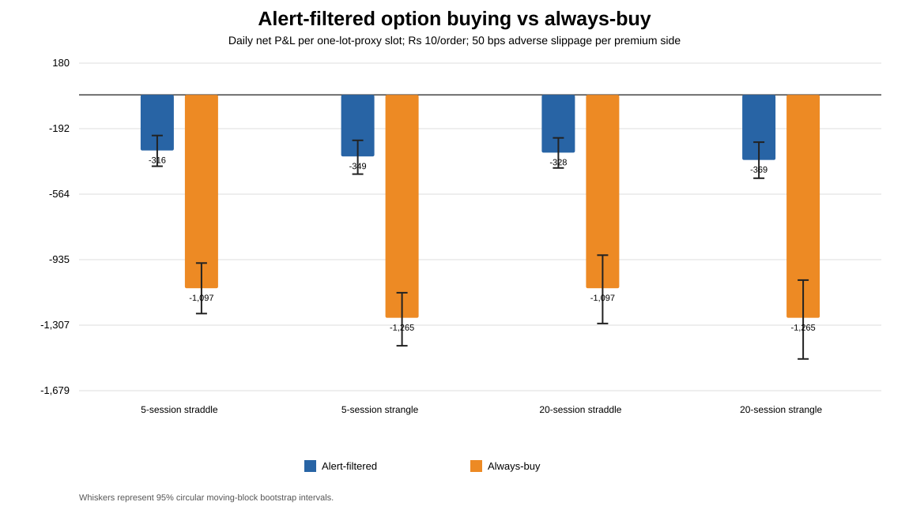
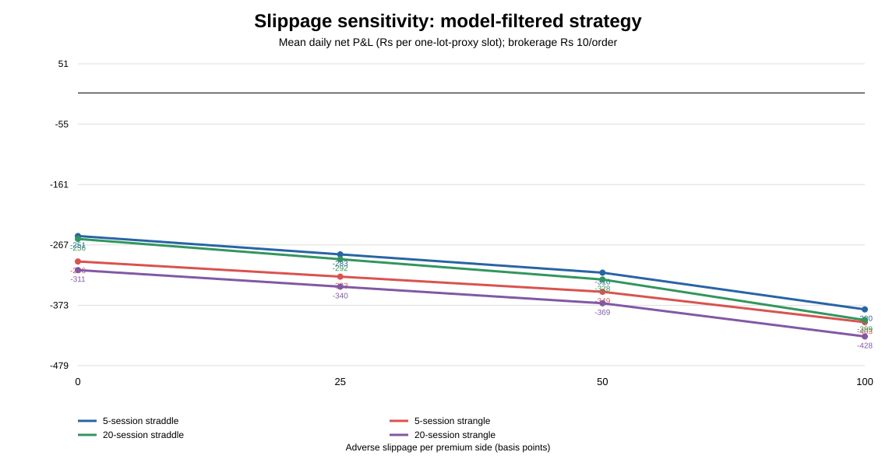

# Do volatility-expansion alerts make intraday NIFTY option buying profitable?

**Study ID:** OPT-BUY-1.0. **Scope:** historical screening only; NIFTY-PRED-1.0 remains closed. **Decision:** INCONCLUSIVE_PARTIAL_OR_INCOMPLETE_DATA

## Abstract

This study evaluates whether a technical Logistic Regression classifier for 5- and 20-session volatility expansion can filter same-session long NIFTY option purchases. Each signal is available only after the preceding underlying-market close. On the next session, the candidate enters at the 09:20 five-minute bar open and exits at the 15:25 five-minute bar close, matching the same numeric strike. It compares an alert-filtered two-leg long straddle or one-step out-of-the-money strangle with buying that same structure on every eligible date. Brokerage, statutory/exchange charges and 0/25/50/100 basis-point adverse-slippage scenarios are included.

The underlying series contains 4,901 daily rows from 2007-01-02 to 2026-10-13; the chronological development/test cutoff is 2022-10-31. The option data gate is FAIL: straddle coverage is 83.98%; strangle coverage is 69.18%; conflicting quote groups are 1.41% of duplicate groups. The prespecified limits are at least 80% coverage for each structure and no more than 1% conflict rate. When those gates fail, the outcome is inconclusive regardless of small comparison p-values. No live strategy is approved.

## 1. Research question, aim and objectives

**Question:** Do 5- or 20-session volatility-expansion alerts yield positive, robust net P&L for intraday long NIFTY options and improve results versus unconditional buying of the same structure?

**Aim:** test the economic value of an already-developed volatility-expansion alert as an option-buying filter, without developing live execution software.

**Objectives:** reconstruct alerts with purged chronological validation; source and validate historical rolling option quotes; match numeric entry/exit strikes; calculate statutory/broker/cost/slippage effects; compare alert filtering with always-buy using paired daily rupee P&L; apply fixed coverage, profitability, robustness and independent-review gates.

## 2. Literature and rationale

A forecast of volatility expansion is not automatically a forecast of positive long-option returns. Implied volatility prices expected movement as well as risk premia and liquidity; the buyer must overcome time decay and transaction costs. Bakshi and Kapadia documented negative average delta-hedged S&P 500 option gains consistent with a negative volatility risk premium; that design differs from these unhedged intraday positions but illustrates that a volatility forecast alone is insufficient (Review of Financial Studies, 2003; https://doi.org/10.1093/rfs/hhg002). Cao and Han related cross-sectional option returns to underlying volatility and frictions for single-stock options (Journal of Financial Economics, 2013; https://doi.org/10.1016/j.jfineco.2012.11.010). Cao et al. document a relation between volatility uncertainty and equity option returns (Quarterly Journal of Finance, 2023; https://doi.org/10.1142/s2010139223500052). These are general motivation, not replications of a NIFTY intraday strategy.

DhanHQ’s expired-options endpoint provides rolling ATM-relative 5-minute option bars for up to five years with up to 30 calendar days per request, but not a historical bid/ask feed (https://dhanhq.co/docs/v2/expired-options-data/).

## 3. Data and methodology

- **Underlying:** 4,901 rows, 2007-01-02 to 2026-10-13; 80/20 chronological split at 2022-10-31.
- **Classifier:** standardized technical Logistic Regression with median imputation, class weighting, C=0.1; thresholds are 75th-percentile of purged, development-only four-fold OOF probabilities. Five-session threshold 0.5347; 20-session threshold 0.6047.
- **Option bars:** 1,062,082 raw rows before cleaning; 1,029,545 usable rows. Request mode MONTH, expiryCode=1; rolling offsets ATM−3 through ATM+3 for calls and puts.
- **Entry/exit:** 09:20 five-minute bar open and 15:25 bar close on the next session; selected numeric strike must match both legs at entry and exact same strike at exit. Missing rows are skipped, never forward-filled. The test only enters and exits in one session.
- **Structures:** long ATM straddle; long one-step OTM strangle must use CALL relative offset +1 and PUT offset −1 at entry, and both actual numeric strikes are followed to exit.
- **Primary outcome:** daily net rupee P&L for one lot-size-proxy slot. Alert-filtered candidate is at zero on non-alert dates; always-buy purchases the same structure on every eligible date. Thus the paired comparison uses a common daily P&L basis, not a percentage denominator that varies by trade.
- **Costs:** ₹10 per executed unique order baseline and ₹20 sensitivity; a complete two-leg round trip counts four orders; option-sale STT 0.10% through 2026-03-31 and 0.15% from 2026-04-01; stamp duty 0.003% on buyer turnover; SEBI fee ₹10/crore, official NSE exchange charge approximation, and 18% GST.
- **Slippage:** each premium entry is worsened and each premium exit reduced by 0, 25, 50 or 100 bps per side. This is a stress approximation because historical bid/ask is unavailable.
- **Statistics:** 2,000 circular moving-block bootstrap replicates; block length equals the forecast horizon; paired candidate-minus-always-buy daily P&L comparison; Holm correction across four primary comparisons; chronological-half and 100-bps stress gates.

## 4. Frozen acceptance gates

The data-quality gate requires an acquisition manifest without failed windows, at least 80% eligible fixed-strike dates for both structures, and a conflicting-duplicate rate at or below 1% after conflicts are discarded. For a candidate to pass it must also have at least 100 alert trades, positive mean daily net P&L with its 95% block-bootstrap lower bound above zero, positive result at 100 bps slippage, positive daily P&L in both chronological halves, and Holm-adjusted outperformance versus always-buy. The data gate cannot be relaxed because a p-value is small.

## 5. Results

**Overall status: INCONCLUSIVE_PARTIAL_OR_INCOMPLETE_DATA. Data gate: FAIL.**

| Horizon | Structure | Alert trades | Filtered net P&L/day (₹) | 95% block CI (₹) | Always-buy P&L/day (₹) | Paired difference/day (₹) | Paired 95% CI (₹) | Holm p | 100 bps positive? | Both halves positive? | Candidate gate |
|---:|---|---:|---:|---|---:|---:|---|---:|---|---|---|
| 5 | straddle | 224 | -315.71 | -405.17 to -230.81 | -1,097.15 | 781.44 | 653.66 to 924.65 | 0.0020 | False | False | False |
| 5 | strangle | 178 | -349.35 | -449.83 to -258.22 | -1,265.49 | 916.14 | 769.77 to 1,070.68 | 0.0020 | False | False | False |
| 20 | straddle | 259 | -327.64 | -414.94 to -244.21 | -1,097.15 | 769.50 | 587.27 to 967.60 | 0.0020 | False | False | False |
| 20 | strangle | 210 | -369.43 | -473.19 to -268.35 | -1,265.49 | 896.05 | 678.13 to 1,143.47 | 0.0020 | False | False | False |

A positive paired difference against an always-buy baseline can mean the filter reduces losses relative to an even worse baseline; it is not proof of profitable option buying. Negative candidate mean P&L or a negative confidence interval lower/upper range is a rejection of the current candidate, and failure of data coverage/conflict gates makes the statistical conclusion inconclusive.

## 6. Discussion

The key distinction is between forecasting higher realized volatility and identifying an option premium that will appreciate enough to cover implied volatility, decay and execution costs. The label spans 5 or 20 sessions, but the trade is closed on the first alerted session’s close. That deliberate mismatch means this is a limited test of immediate monetization, not a direct position held for the classifier’s full target horizon. The rolling contract source also lacks historical bid/ask and stable expiry-specific contract identity, so slippage and lot-sizing remain proxies.

## 7. Strengths

- Chronological held-out origins with a development-only OOF threshold and horizon purge.
- Same-session actual strike matching; missing quotes are skipped rather than filled or substituted.
- Brokerage, statutory/exchange charges, slippage scenarios, block confidence intervals and Holm correction are prespecified.
- An independent audit recomputes ledger arithmetic, primary outcomes, bootstrap intervals and multiple-comparison adjustment from the sanitized ledger.

## 8. Limitations

- If coverage is below 80% or conflict rate above 1%, no strategy inference is accepted even if a comparison p-value is small.
- Rolling options are not the same as stable, expiry-identified option contracts across multiple days; overnight/multi-day P&L is not tested.
- OHLC fills do not equal historical executable bid/ask; the slippage stress may understate tail events.
- Lot size uses a trade-date proxy rather than a contract-master reconstruction for the exact expiry.
- Only one chronological test window is analyzed; there is no prospective paper-trading period.

## 9. Conclusion

**INCONCLUSIVE_PARTIAL_OR_INCOMPLETE_DATA.** No option-buying strategy is validated or approved. If the current candidates have negative net daily P&L, a significant paired improvement only establishes reduced losses versus the unconditional baseline; it does not establish a profitable edge. The next bounded run enforces the exact one-step OTM strangle and reruns the quality gates without changing thresholds or relaxing criteria.

## 10. Future direction

Research directions after this bounded study: acquire verified expiry/contract/lot-size and historical bid/ask data; align the target horizon with the holding period using a one-session intraday volatility-expansion label; test implied-versus-realized volatility pricing and event costs; require multiple walk-forward test periods and a locked untouched final holdout; then consider a prospective paper-trading period only after a separate independent test passes.

## Appendix A — transaction accounting

- Gross P&L = (combined exit premium points − combined entry premium points) × lot-size proxy.
- Slippage cost = (entry premium + exit premium) × (bps/10,000) × lot-size proxy.
- Net P&L = gross P&L − slippage − brokerage − STT − stamp duty − SEBI fee − exchange charges − GST.
- Two legs opened and closed mean four executed orders per completed trade.

## Appendix B — references

1. DhanHQ, Expired Options Data API v2: https://dhanhq.co/docs/v2/expired-options-data/
2. NSE, STT schedule for equity derivatives: https://www.nseindia.com/static/products-services/equity-derivatives-securities-transaction-tax
3. NSE Circular (equity options exchange charges from 2026-03-01): https://nsearchives.nseindia.com/content/circulars/FA73061.pdf
4. NSE, SEBI turnover fees, stamp duty, STT and other levies: https://www.nseindia.com/static/invest/first-time-investor-sebi-turnover-fees-stt-other-levies
5. Paytm Money, F&O brokerage FAQ: https://www.paytmmoney.com/stocks/customer/fno-faq/onboarding-and-kyc/account-segment-activation/how-to-activate-fo-from-mobile-app-web
6. Bakshi, G. & Kapadia, N. (2003). Delta-Hedged Gains and the Negative Market Volatility Risk Premium. Review of Financial Studies 16(2), 527–566. https://doi.org/10.1093/rfs/hhg002
7. Cao, J. & Han, B. (2013). Cross section of option returns and idiosyncratic stock volatility. Journal of Financial Economics 108(1), 231–249. https://doi.org/10.1016/j.jfineco.2012.11.010
8. Cao, J. J., Vasquez, A., Xiao, X. & Zhan, X. (2023). Why Does Volatility Uncertainty Predict Equity Option Returns? The Quarterly Journal of Finance 13(1), 2350005. https://doi.org/10.1142/s2010139223500052

## Appendix C — reproducibility files

- Acquisition summary: ../../reports/option_validation/acquisition_summary.json
- Quote quality: ../../reports/option_validation/quote_quality.json
- Results: ../../reports/option_validation/results_summary.json
- Primary comparisons: ../../reports/option_validation/primary_comparisons.csv
- Cost/slippage matrix: ../../reports/option_validation/performance.csv
- Sanitized trade ledger: [run #11 artifact ZIP](https://github.com/vishnuvcr/Naked-Options-v2/actions/runs/38548437384), which contains the 48,032-row `reports/option_validation/trade_ledger.csv`. Restricted raw option quotes are not included.
- Restricted raw quote responses are stored only in the Actions cache and are not published.

**Independent tester handoff:** recompute quote coverage/conflict counts, fixed-strike matching, P&L/cost arithmetic, bootstrap intervals and Holm adjustment from raw/cached inputs and the sanitized ledger. Block if any gate fails.
