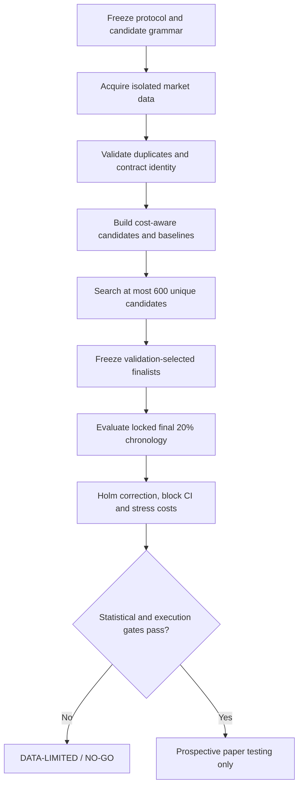

# QE-NOB-1.0: A bounded QuantEvolve-inspired search for NIFTY 50 naked option buying

**Status:** corrected frozen-candidate reprice completed; no candidate met the cost-robustness gates. Previous P&L metrics are superseded; a single full corrected evolution workflow remains as supplementary confirmation. No independent tester per user's explicit instruction.  
**Latest data-quality run:** [#39741806754](https://github.com/vishnuvcr/Naked-Options-v2/actions/runs/39741806754) · **Period:** 2021-10-25 to 2026-10-21. Corrected source/test workflow [#39774033025](https://github.com/vishnuvcr/Naked-Options-v2/actions/runs/39774033025) is pending.  
**Protocol:** [PLAN.md](PLAN.md) · [Results](RESULTS.md) · [Phase status](PHASE_STATUS.md) · [Error log](ERROR_LOG.md).

## Abstract

This study used a bounded QuantEvolve-inspired quality-diversity search to explore NIFTY 50 long-premium option-buying rules. Eligible positions were long calls, long puts, long straddles and long strangles; short-option legs were excluded. Four islands evaluated 600 unique candidates over nine completed generations. The dataset comprised 92,510 underlying rows and 2,600,975 rolling option rows across 1,241 sessions. After adding ATM offset to the duplicate key, no duplicate groups or rows were removed. This validates request identity only, not exact exchange contract identity. Candidates were selected using chronological training/validation data, and the latest 20% chronology was reserved for final evaluation. After-cost P&L, baseline comparisons, Holm multiplicity correction, block-bootstrap uncertainty, split-half checks and adverse cost stress tests were included.

The first completed run's original P&L values were superseded because its lot-size proxy was wrong. A frozen-candidate reprice audit has now recalculated 483,706 trades using the corrected date/family proxy. No candidate in this saved set met the combined daily-median, validation and stress-cost prerequisites. Missing bid/ask/depth did not block the statistical reprice; the analysis uses next-bar option OHLC and explicitly modeled slippage and fees. Exact contract identity and executable fills remain unresolved, so paper/live claims are prohibited. A corrected full evolutionary workflow is still in progress as supplementary confirmation.

## 1. Research questions and hypotheses

1. Can a bounded evolutionary search discover after-cost rules that outperform fixed-buy benchmarks?
2. Does any candidate retain positive, statistically credible net performance on a locked chronological OOS block after family-wise correction?
3. Are candidate results stable across OOS halves and adverse cost assumptions?
4. Are the data and execution assumptions sufficiently verified to interpret simulated P&L as executable?

H1 predicted a positive OOS edge; H2 a significant edge after multiplicity correction and paired benchmark comparison; H3 stability under split-half and stress testing; H4 valid data and execution gates. The run did not support H2–H4; H1 is not established robustly.

## 2. Scope and method

The study started from a fresh evidence namespace; prior research findings were not used as candidate rankings, parameter seeds or evidence. The implementation is **QuantEvolve-inspired**, not a reproduction of the original LLM multi-agent system: it uses deterministic research/evaluation roles and a constrained rule grammar, not unrestricted LLM-generated strategy code.

The bounded search evaluated 600 unique candidates in four islands, completed nine generations, and retained a quality-diversity archive of 28 niches. Validation selection used a composite of net P&L, Sharpe, profit factor and drawdown; final OOS metrics did not drive candidate discovery.



### Chronology

Training ended 2024-10-17; validation ended 2025-10-17; the final 20% chronology was held for confirmation. Search decisions used training/validation only.

## 3. Data and quality

| Measure | Result |
|---|---:|
| Window | 2021-10-25–2026-10-21 |
| Sessions | 1,241 |
| Underlying rows | 92,510 |
| Option rows | 2,600,975 |
| Unique candidates / islands / generations | 600 / 4 / 9 |
| Duplicate groups after offset-aware key | 0 |
| Conflicting duplicate groups | 0 |
| Rows excluded for conflicts | 0 |
| Option timestamp coverage | 99.772% |
| Row-grid coverage | 100% |
| Statistical gate passes | 0 |
| Execution/promotion gate passes | 0 |

The source provided rolling ATM-relative OHLC, IV, OI, volume and spot—not a stable fixed-contract tape with historical executable bid/ask and depth. Intermittent Dhan HTTP 502 failures are recorded in `source_failures.csv`. The duplicate/grid diagnostic now passes after including offset; this does not establish stable contract identity. The execution gate remains blocked.

## 4. Costs and statistical analysis

Primary results used one-lot simulated P&L with next-bar-open pricing and prespecified adverse slippage. Stress scenarios included 100 and 200 basis points of adverse slippage with ₹20 per order. Broker charges remain provisional because the effective-date Paytm Money tariff has not been verified. There are no historical bid/ask/depth observations to validate fill prices. Consequently, P&L is a simulation from rolling OHLC, not proof of executable returns.

Evaluation included Holm-adjusted candidate-family p-values, block-bootstrap intervals for daily net P&L, OOS split-half metrics, drawdown/profit-factor diagnostics, and paired comparisons with fixed-buy baselines. No candidate cleared all gates.

## 5. Preliminary results from the superseded lot-size run (not final)

### Best validation-selected candidate

Candidate 86: opening-gap continuation after a gap of at least 0.15%, MONTH1 rolling-option flag, moneyness offset 1, 120-minute hold.

| Metric | Result |
|---|---:|
| Validation mean daily net | ₹157.94 |
| OOS trades | 151 |
| OOS total net P&L | ₹2,659.70 |
| OOS mean daily net | ₹10.68 |
| OOS median daily net | ₹0.00 |
| 95% block-bootstrap CI for OOS mean daily net | -₹188.62 to ₹237.43 |
| OOS win rate / profit factor | 49.67% / 1.021 |
| OOS Sharpe / max drawdown fraction | 0.097 / 6.46% |
| Holm-adjusted p | 1.0 |
| Paired difference vs fixed-buy benchmark | +₹65.45/day |
| Paired 95% interval | -₹250.19 to ₹397.71 |
| Paired one-sided HAC p | 0.350 |
| First OOS half mean daily net | +₹109.76 |
| Second OOS half mean daily net | -₹87.60 |
| 100-bps + ₹20/order stress mean daily net | -₹98.54 |
| 200-bps + ₹20/order stress mean daily net | -₹288.37 |

The positive base point estimate is small relative to uncertainty, OOS halves have opposite signs, adjusted significance is absent, the paired interval crosses zero, and stress-cost returns are negative.

### Selected finalist comparison

| Candidate | Family | OOS mean/day | 95% CI low | Holm p | Gate |
|---:|---|---:|---:|---:|---|
| 86 | Gap continuation | ₹10.68 | -₹188.62 | 1.0 | Fail |
| 548 | Gap continuation | ₹15.73 | -₹182.11 | 1.0 | Fail |
| 223 | Gap continuation | -₹24.58 | -₹214.72 | 1.0 | Fail |
| 13 | Fixed-time long call | -₹172.22 | -₹427.51 | 1.0 | Fail |
| 45 | Initial-move momentum | -₹54.76 | -₹357.99 | 1.0 | Fail |
| 349 | Gap continuation | ₹1.61 | -₹209.33 | 1.0 | Fail |
| 166 | Opening-range breakout | -₹25.85 | -₹262.20 | 1.0 | Fail |
| 173 | Gap continuation | ₹23.67 | -₹121.18 | 1.0 | Fail |
| 332 | Gap continuation | ₹70.35 | -₹49.03 | 1.0 | Fail |
| 303 | Gap continuation | ₹61.11 | -₹69.99 | 1.0 | Fail |

All 20 validation-selected finalists failed the statistical gate; all 600 candidates failed the strict execution/promotion gate. The full 600-candidate metrics and 20-finalist table are in the [latest completed workflow artifact](https://github.com/vishnuvcr/Naked-Options-v2/actions/runs/39741806754).

### Stress comparison (mean daily net, ₹; simulated)

```text
Base modeled costs       +10.68 | █
100 bps + ₹20/order      -98.54 | █████
200 bps + ₹20/order     -288.37 | ██████████████
```

## Corrected lot-size reprice audit (frozen prior candidate set)

The superseded run's 483,706-row sanitized trade ledger was re-priced with the corrected date/family lot proxy and the same cost equations. This does not substitute for a fresh evolutionary search because the old population was generated/scored under the incorrect proxy; it is a bounded sensitivity check on all saved trade rows. See [reproducible audit report](LOT_SIZE_REPRICE_AUDIT.md).

| Candidate | OOS mean/day | OOS median/day | 100-bps / ₹20 order stress | 200-bps / ₹20 order stress | Key failure |
|---|---:|---:|---:|---:|---|
| 86 — Monthly gap continuation, 120 min | ₹6.14 | ₹0.00 | −₹104.19 | −₹296.25 | Median and cost robustness |
| 558 — Weekly gap continuation, 15 min | ₹70.37 | ₹0.00 | ₹10.02 | −₹80.53 | Median and severe stress |
| 501 — Weekly ORB, 30 min | ₹44.06 | ₹41.40 | −₹43.99 | −₹173.83 | Validation and cost robustness |
| 588 — Monthly ORB, 30 min | ₹23.81 | ₹69.30 | −₹147.26 | −₹443.16 | Validation and cost robustness |
| 264 — Weekly pullback, 120 min | ₹126.11 | ₹0.00 | ₹76.99 | ₹4.74 | Only 137 OOS trades, no validation result, zero median |

Only two candidates combined at least 150 OOS trades with positive daily median; both failed validation and cost stress. No candidate in the frozen set passed the preregistered conjunctive gates. Exact HAC/block-bootstrap inference from the full underlying session grid still belongs to the active corrected workflow; the local audit's Holm diagnostic is explicitly approximate because seven zero-trade sessions were not represented in the trade-ledger export.

## 6. Discussion and inferences

1. **No evidence-supported winner was identified in the corrected frozen-candidate reprice.** None of the 600 saved candidates met the combined daily-median, validation and cost-stress prerequisites. The corrected full evolutionary run was still in progress at the last status check.
2. **This is not proof of universal inefficiency.** Some frozen candidates retain positive mean daily OOS P&L, but positives are unstable, fail validation, fail cost stress, or fail the multiplicity/median requirements.
3. **Duplicate-key diagnosis was corrected.** ATM offset was missing from the old key; the regression test now prevents conflating separate rolling requests. This request-identity fix does not prove exact exchange contract identity.
4. **Execution realism remains unresolved, but did not block this statistical reprice.** Historical bid/ask/depth and stable contract IDs are absent; exact fills cannot be claimed. Dated lot sizing is now a sourced WEEK1/MONTH1 proxy, not an exact instrument-master join.
5. **Evolution increases selection risk.** The saved candidate population was originally searched with the defective lot proxy, so its reprice is a bounded sensitivity audit rather than the final corrected evolution path. The Holm-adjusted diagnostic showed no multiplicity-adjusted pass.
6. **Method label matters.** This was a deterministic constrained adaptation inspired by QuantEvolve, not the original LLM multi-agent implementation.

## 7. Strengths and limitations

**Strengths:** fresh isolated research namespace; bounded 600-candidate budget; chronological train/validation/OOS; OOS not used for evolution; Holm correction and block uncertainty in the full workflow; fixed-buy comparisons; cost stress; corrected offset-aware duplicate key; official NSE lot-size circulars; failed requests preserved; dated-lot regression tests.

**Limitations:** the corrected frozen-candidate audit used the previous candidate set, whose evolution path was affected by the bad lot proxy; seven no-trade session dates were not present in the ledger export, so the local HAC/Holm sensitivity screen inserts zero days evenly and is explicitly approximate; no historical bid/ask/depth or stable exact contract ID; the lot-size mapping is still an entry-date/family proxy; account-specific Paytm Money tariff may differ; intermittent HTTP 502s; candidate point estimates are unstable; the study does not reproduce original QuantEvolve. The user explicitly declined a tester, so no independent review is claimed.

## 8. Conclusion

**NO-GO for strategy approval on the available evidence.** The corrected frozen-candidate reprice found no candidate in the saved 600-candidate set passing the combined daily-median, corrected-validation and stress-cost prerequisites. The prior validation-selected gap-continuation candidate averaged only about ₹6/day out of sample and lost about ₹104/day under 100-bps/₹20-order stress. Other candidates had positive average OOS P&L but failed other gates. This does not prove every possible NIFTY option strategy is unprofitable; it means no supported winner has been established within this bounded study. Available OHLC prices were sufficient for the reprice. Missing historical bid/ask/depth and exact contract identity remain limitations on execution claims, not blockers to statistical analysis. The corrected full evolutionary workflow was a single supplementary check in progress at the last status check; no live or paper strategy is approved.

## 9. Future directions

1. Diagnose rolling-relative duplicate-key semantics using small reproducible samples and payload hashes.
2. Reconcile expiry dates, strikes, option types, instrument IDs and lot sizes against dated official NSE contract files.
3. Exhaust lawful free sources for executable bid/ask/depth data before considering paid sources.
4. Freeze Paytm Money brokerage, STT, exchange fees, GST and stamp duty by effective date.
5. Rerun the frozen protocol only after the data gates pass; do not tune rules based on locked OOS outcomes.
6. If any candidate clears all gates, require a separately approved prospective paper-trading period with quote/order logs. No automatic live deployment.
7. Stop if lawful free data cannot resolve contract identity and execution limitations; do not search endlessly.

## Appendix A. Gate summary (updated during correction)

| Gate | Current status | Reason |
|---|---|---|
| Data volume | Passed | Multi-year underlying/options rows acquired |
| Duplicate/grid quality | Passed | Offset-aware duplicate key: 0 duplicate groups, 0 rows dropped |
| Lot-size scaling | Repriced with sourced family/date proxy | 483,706 trade rows were repriced; exact exchange contract IDs remain unavailable |
| Search budget | Prior run completed | 600 candidates / 9 generations in the previous search; its search path used defective lots |
| Frozen-candidate reprice | Complete — NO-GO | No candidate met joint median, validation and cost-stress prerequisites |
| Statistical significance | No pass in audit screen | Approximate reconstructed HAC/Holm diagnostic; exact full-grid inference remains with the active corrected workflow |
| Cost robustness | Failed for plausible finalists | The only two candidates with positive OOS daily median failed 100-bps/₹20-order stress and corrected validation |
| Execution realism | Limitation remains | No validated historic bid/ask/depth or exact contract ID; OHLC analysis proceeds anyway |
| Promotion | NO-GO | No strategy approved; no paper/live recommendation |

## Appendix B. Reproducibility and artifact map

- [Workflow run and artifact](https://github.com/vishnuvcr/Naked-Options-v2/actions/runs/39712854501)
- `run_summary.json`: splits, evolution trace, gates and best finalist.
- `candidate_results.csv`: all 600 candidates and metric families.
- `validation_finalists_oos.csv`: validation-selected OOS finalists and paired baselines.
- `source_probe.json`, `acquisition_summary.json`, `underlying_summary.json`: acquisition/source diagnostics.
- `source_failures.csv`: failed request log.
- `trade_ledger_sanitized.csv`: large per-trade ledger retained in downloadable artifact rather than Git.
- [Automated tests](test_run_research.py) · [Workflow](../../.github/workflows/quant-evolve-nob.yml).

## Appendix C. Developer handoff

Treat [LOT_SIZE_REPRICE_AUDIT.md](LOT_SIZE_REPRICE_AUDIT.md) as the usable frozen-candidate conclusion. Inspect the already-running corrected workflow only once; if it completes with materially different results, reconcile those values without reopening unbounded search. Missing quotes do not block OHLC research but still block executable-fill claims. Do not recommend paper or live deployment. No tester branch/report is requested by the user.
